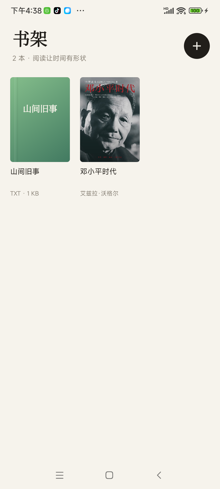
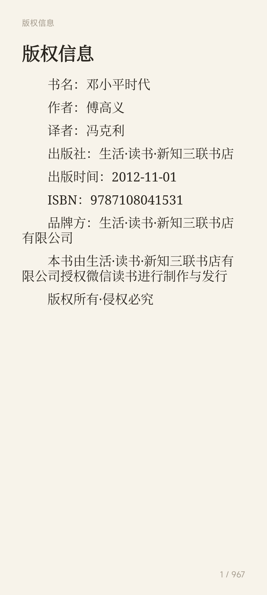
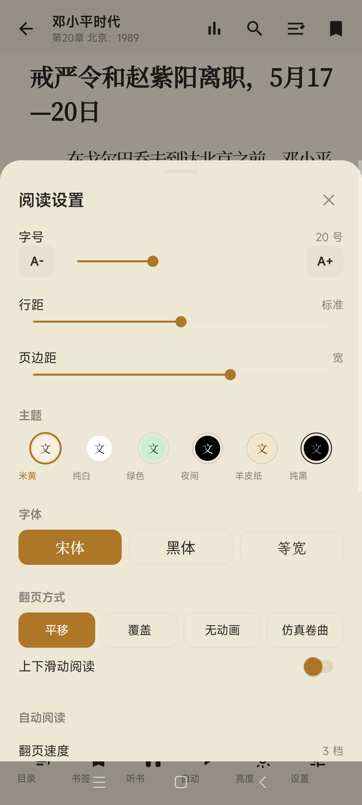
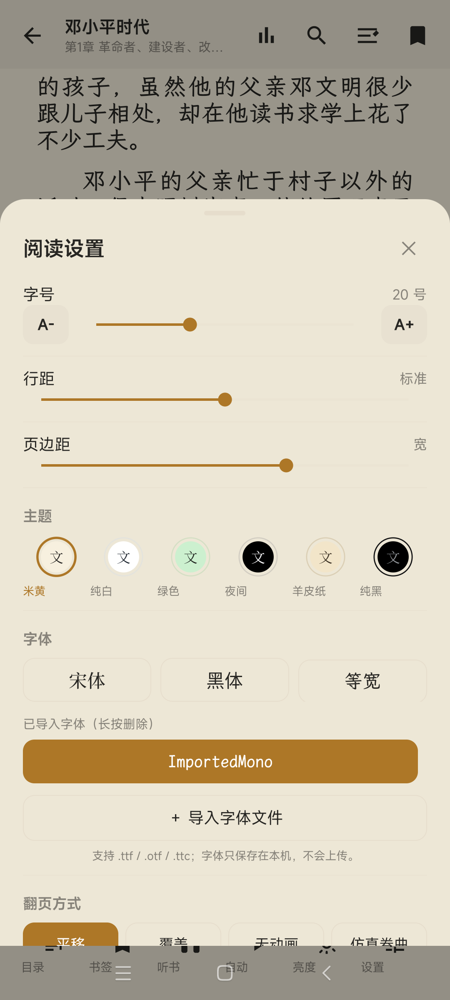
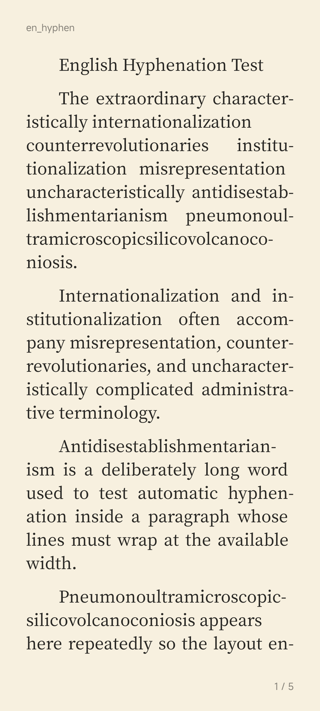

# 墨阅 · 微信读书风格 EPUB/TXT 阅读器

[GitHub](https://github.com/leporiinflabless-maker/moyue-reader-release) · [Gitee](https://gitee.com/mhwpub/moyue-reader-release)

一个用 Kotlin 实现的 Android 本地电子书阅读器，复刻微信读书阅读器的核心排版与交互。

## 下载

| 文件 | 版本 | 大小 | SHA-256 |
|---|---|---|---|
| [moyue-reader-v1.0.1.apk](moyue-reader-v1.0.1.apk) | v1.0.1 | 66,842,064 B | `F7F0697ECD51E7FCEE8FB048A286B68CB928EEE37F08DFF483F91F3F1636CCB7` |

要求：Android 8.0+（minSdk 26），支持 arm64-v8a / armeabi-v7a。

## 功能

- **本地格式**：EPUB 2/3、TXT（UTF-8/GB18030/UTF-16），无 DRM。
- **排版**：自研 `MoyueLayout`，微信 `libLineBreak-v2.so` UAX #14 断行，DS typeset 节点模型与 4-fitness 最优断行，ICU 中文词内禁则，行首/行尾标点禁则，英文 Liang/TeX 断词。
- **字体**：内置思源宋体 Medium、Noto Sans CJK SC、霞鹜文楷等宽 Medium；支持用户从本机导入 `.ttf/.otf/.ttc` 字体。
- **基线**：按微信 `CharElement`/`Paragraph` 对齐整数字宽、行高、基线、行盒 drawOffset、fake bold、斜体 skew 和上标/下标偏移。
- **主题与设置**：6 套主题、12 档字号、7 档行距/边距、页眉页码、首行缩进、段落间距。
- **阅读交互**：选词/选择柄、划线/笔记、全书搜索、系统词典、字符锚定书签、目录、阅读统计。
- **翻页**：平移/覆盖/无动画/仿真卷曲，上下滑动，自动阅读，横屏双页。
- **听书**：EdgeTts 在线语音、逐句朗读、逐词高亮、迷你播放器、睡眠定时、后台播放。v1.0.1 修复词高亮行末坐标、软连字符映射和跨页长句自动翻页。

## 截图

| 书架 | 阅读 |
|---|---|
|  |  |

| 字体设置 | 导入字体 |
|---|---|
|  |  |

| 英文断词 | 横屏双页 |
|---|---|
|  |  |

## 说明

- 本项目不包含微信读书账号、书城、推荐、会员、DRM 或云端同步。
- 仅支持本地导入的无 DRM EPUB/TXT。
- 内置字体为 SIL OFL 开源字体；商业字体（方正、汉仪、仓耳等）不随 APK 分发，用户可通过“导入字体”使用自己已授权的文件。
- 本仓库只发布 APK 与说明，不包含微信读书 APK、商业字体或书籍内容。
